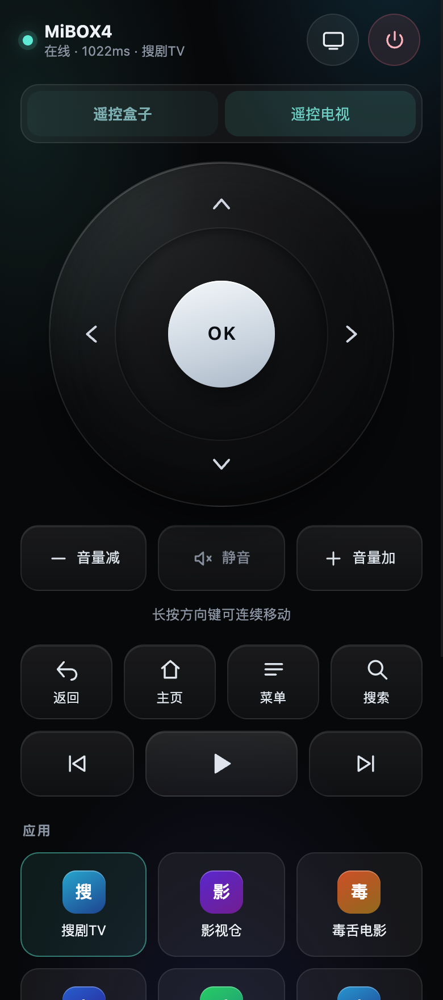
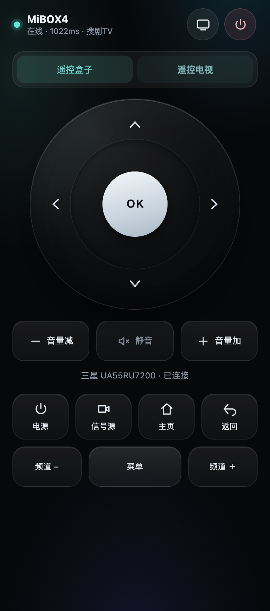

<div align="center">

# MiBox TV Remote

**一个网址，同时遥控安卓电视盒子和三星电视。**

不需要 App，不需要红外，不需要 root。手机浏览器打开就是遥控器。

[](https://www.python.org/)
[]()
[](LICENSE)
[]()

 

</div>

---

## 这是什么

把一台**常开的局域网设备**（Mac / 树莓派 / 旧安卓手机）变成遥控中枢：

| 控制对象 | 技术路径 | 能做什么 |
|---|---|---|
| 安卓电视盒子（小米盒子等） | ADB + 内核输入设备 | 方向/确认/返回/主页、音量、应用直达、截屏、文字输入 |
| 三星电视（Tizen 2016+） | 局域网 WebSocket（8002） | 音量、静音、信号源、主页/返回、开关机 |

手机端就是一个 PWA 页面：打开网址 → 添加到主屏幕 → 像 App 一样用。**盒子模式和电视模式在同一个页面切换**。

---

## 为什么值得自己搭一套

市场上不缺电视遥控 App，但基本都要装 App、要账号、要联网经过厂商服务器。这个项目：

- **零安装**：手机端就是一个网页
- **零依赖**：Python 标准库，`pip install` 一行都不需要
- **零外网**：全部在局域网内，不经过任何第三方服务器
- **可自己改**：两百多行 Python，改按键、加功能都直接改

---

## 实测延迟

在小米盒子 4（Android 6.0.1，2016 年的硬件）上实测：

| 操作 | 耗时 | 说明 |
|---|---|---|
| 盒子方向键 | **0.3 – 0.5s** | 走 `sendevent` 写内核输入设备 |
| 盒子主页/电源 | ~1.3s | 必须走框架 `input keyevent`，进程启动慢 |
| 三星电视任意键 | **0.03 – 0.08s** | 常连接 + 后台预热 |
| 截屏返回手机 | ~2 – 6s | Android 6 软件编码慢，无解 |

> 盒子按键最初用 `input keyevent` 是 **1.3 秒/次**，完全没法用。换成直接写 `/dev/input/event0` 之后降到 0.3 秒——这是这个项目最关键的一次优化。

---

## 工作原理

```
┌─────────────┐    HTTP/JSON     ┌──────────────────────┐
│  手机浏览器  │ ───────────────▶ │  bridge (server.py)  │
│  (PWA 遥控器)│ ◀─────────────── │  Python 标准库，无依赖│
└─────────────┘                  └──────┬─────────┬─────┘
                                        │         │
                            ADB (TCP 5555)    WebSocket (TLS 8002)
                                        │         │
                                 ┌──────▼───┐ ┌───▼──────────┐
                                 │ 安卓盒子 │ │ 三星电视     │
                                 └──────────┘ └──────────────┘
```

`server.py` 维持一条**长驻 `adb shell`**（每次新起一个 shell 要 1.3 秒），把命令写进去执行；
按键则单独开一个短命 shell 直接 `sendevent` 写内核输入设备——两条路各取所长。

---

## 快速开始

### 1. 前提

- 一台常开的机器（Mac / Linux / 树莓派 / 装了 Termux 的旧安卓手机）
- 安装 `adb`：macOS `brew install android-platform-tools`
- 盒子和这台机器在**同一个局域网**

### 2. 打开盒子的网络调试

盒子设置里打开「开发者选项 → USB 调试 / 网络调试」，确认 5555 端口能连：

```bash
adb connect 192.168.1.100:5555
adb devices          # 必须显示 device，不是 unauthorized
```

> 第一次连接时盒子上会弹「允许 USB 调试吗」，用遥控器点允许（勾「一律允许」）。

### 3. 配置并启动

```bash
cp config.example.json config.json    # 改成你的盒子 IP
bash install.sh                       # macOS LaunchAgent / Linux systemd，开机自启
```

装完会打印地址，例如：

```
手机打开：http://192.168.1.50:8795
```

### 4. 手机添加主屏幕

手机浏览器打开上面的地址 → 菜单 → **添加到主屏幕**。之后点图标就是全屏遥控器。

> 在 Android 手机上自建自用，还可以打开 `http://127.0.0.1:8795`（本机访问本机，不走网络，最快）。

---

## 多设备：盒子 + 投影仪 + 电视

一个页面同时管几台 adb 设备（电视盒子、投影仪、开发板…），顶上三个页签一点就切：

- 每台设备各有一条长驻 `adb shell`，切换只改指针，**切回来是秒回**，不用重新连接。
- 切走前会先把旧设备的键全部补一个 up，防止卡键（不然会出现"没人碰它、App 自己弹出来"）。
- 页签只决定发去哪台；`config.json` 里的 `active` 记录当前设备，重启桥接后保持不变。
- 三星电视走独立的 Tizen 通道，不占 adb 槽位。

页面上顶部的电源键**跟着页签走**：电视档发三星的 `POWER`，盒子/投影仪档发对应设备的 `POWER`。

加一台设备只要在 `config.json` 的 `devices` 里加一项，重启桥接即可。

---

## 配置说明

`config.json`：

| 字段 | 说明 |
|---|---|
| `devices[]` | 要控制的 adb 设备，一台一个对象（字段见下表） |
| `active` | 当前设备 id，页面上点页签会写回这里 |
| `bind` / `port` | 监听地址和端口，默认 `0.0.0.0:8795` |
| `tv_ip` / `tv_port` | 三星电视地址，默认 8002；不用电视留空即可 |
| `tv_token` | 配对后自动写入，别手改 |

`devices[]` 每一项：

| 字段 | 说明 |
|---|---|
| `id` | 唯一 id，页签和 `active` 都用它 |
| `label` | 页面上显示的名字（小米盒子 / 投影仪…） |
| `serial` | adb 地址，如 `192.168.1.100:5555` |
| `model` | 机型，IP 变了靠它自动认回来（`getprop ro.product.model`） |
| `input_dev` | 按键注入的输入设备，一般 `/dev/input/event0` |
| `screencap` | 可选。`pull` = 用 `screencap -p` + `adb pull` 截屏，给 `exec-out` 坏掉的设备（不少投影仪/老固件如此） |

设备 **IP 变了也不用管**：连不上时会扫一遍网段找开着 5555 的主机，认机型对上就自动改配置。
想彻底不折腾，就在路由器里给每台设备按 MAC 做一条 DHCP 固定地址。

应用快捷入口按设备分开，在 `server.py` 顶部 `APPS_BY_ID` 里改（`mibox` / `projector` 各一份）。

```bash
adb shell pm list packages -3          # 查你盒子上的第三方应用包名
adb shell dumpsys window | grep mCurrentFocus   # 查当前前台应用
```

---

## HTTP API

| 方法 | 路径 | 说明 |
|---|---|---|
| GET | `/api/status` | 当前设备在线状态、前台应用、按键耗时，`devices` 里带每台的在线情况 |
| POST | `/api/switch` | `{"id":"projector"}` 切换当前设备（会顺带 connect 一次） |
| POST | `/api/key` | `{"key":"UP","n":1}` 发按键（`n` 为连发次数） |
| POST | `/api/app` | `{"pkg":"com.example.tv"}` 启动应用 |
| POST | `/api/text` | `{"text":"hello"}` 输入文字（仅 ASCII） |
| GET | `/api/shot` | 截屏，返回 JPEG |
| POST | `/api/connect` | 重连盒子 |
| POST | `/api/discover` | 扫描局域网重新找盒子 |
| GET | `/api/tv/status` | 电视连接状态 |
| POST | `/api/tv/key` | `{"key":"VOL_UP"}` 电视按键 |
| POST | `/api/tv/pair` | 首次配对（电视上点「允许」） |

---

## 踩过的坑（这个项目最有价值的部分）

都是实测出来的，不是猜的：

| 现象 | 真正原因 | 解法 |
|---|---|---|
| 每个键要 1.3 秒，完全没法用 | `input keyevent` 每次都要现起一个 ART 进程 | 改走 `sendevent /dev/input/event0` 直接写内核输入设备，0.3s |
| 长驻 `adb shell` 里跑 `sendevent` 会卡死 | pty 会处理输出的行、事件被缓冲 | 按键必须用**独立的** `adb shell "<cmd>"`（非 pty） |
| 用标记判断命令执行完，结果错位 | pty 会把命令行**回显**出来，标记匹配到了回显本身 | 标记用算术展开生成：命令行里是 `$((500000+7))`，输出才是 `S500007__` |
| 发 `KEYCODE_DPAD_CENTER` 盒子不理会 | 这个固件的「OK」键认的是 `KEY_ENTER(28)` | 查 `/system/usr/keylayout/Generic.kl` 的映射表，按实际情况来 |
| 写 `KEY_HOME` 到内核设备无效 | 系统只认框架层的 HOME 事件 | HOME / POWER 单独走 `input keyevent`，慢一点但有效 |
| 电视上偶尔"没人碰它，App 自己一个个弹出来" | 按键是「按下+抬起」两个事件，连接断开时抬起丢了，系统以为键一直按着 | 启动时、失败时、每分钟各补发一次"全部松开" |
| 手指滑动页面，应用列表里的 App 一个接一个被打开 | 按钮绑在 `pointerdown`（手指一碰就触发），滚动时划过即触发 | 离散按钮改用 `click`，只有"按下+抬起且没移动"才算点击 |
| 三星电视连不上，0.0 秒就回绝 | 用了 8001 端口，这个型号只认 **8002 的 TLS 通道** | 换 8002 + 自签证书不校验 |
| 三星电视按键全没反应，但电视本身好的 | 配对 token 失效（电视待机太久/断电重启） | 重新配对；代码里加"空闲 90 秒先重连 + 发送失败重连重试" |

---

## 部署到旧安卓手机（Termux）

把一台旧手机插着电扔角落当常驻中枢，零成本：

```bash
# 手机上装 Termux（GitHub 的 github-debug 版，debuggable，方便脚本化部署）
# 然后：
pkg install python android-tools
# 若 adb 报 "cannot locate symbol _ZNSt6__ndk113__hash_memory"
pkg install libc++

# 把项目拷进 ~/tv-remote，启动
cd ~/tv-remote && nohup python3 server.py >> termux.log 2>&1 &
```

**Android 12+ 必做**，否则后台进程会被系统杀掉：

```bash
adb shell settings put global settings_enable_monitor_phantom_procs false
adb shell dumpsys deviceidle whitelist +com.termux
```

三个容易忽略的点：

- Termux **没有 `/tmp`**，adb 会去写 `/tmp/adb.<pid>.log` 直接失败 → 必须 `export TMPDIR=$PREFIX/tmp`（`server.py` 已自动处理）
- 同一台盒子**同时只接受一个 adb host**，两个桥接同时在跑会互相踢成 `offline`
- 开机自启装 `Termux:Boot`，脚本放 `~/.termux/boot/`，第一行先 `termux-wake-lock`

桌面一键图标：装 `Termux:Widget`，脚本放 `~/.shortcuts/`，
并给 Termux 授予「显示在其他应用上层」权限（否则安卓会拦掉"后台弹起界面"）。

---

## 三星电视配对

1. 记下电视 IP（路由器里看，或者扫 8001 端口）
2. 页面切到「三星电视」→ 点状态行「未连接（点这里配对）」
3. 电视屏幕会弹「允许连接」，用三星遥控器点允许
4. token 自动存进 `config.json`，之后不再弹窗

> 电视待机太久或断电重启可能导致 token 失效，按键没反应时重新点一次配对即可。

---

## 已知限制

- **盒子侧**：`input text` 只支持 ASCII，中文输入需要额外装输入法；截屏在 Android 6 上要 2–6 秒
- **投影仪/老固件**：`adb exec-out screencap` 可能直接是坏的（输出被启动日志污染、要十几秒），这时配 `"screencap": "pull"`；pull 本身也要 3–15 秒，页面首张截图偶尔失败，重试即可
- **页签切换**：`/api/status` 有 6 秒轮询，前端必须按 `device` 字段过滤过期响应，否则切完页签标题会被旧设备刷回去；电视档干脆不要轮询 adb 设备
- **电视侧**：只支持三星 Tizen（2016 年及以后）；其他品牌需要各自协议。电视**完全待机**时 WebSocket 是断的，遥控唤不醒，要开机得另做局域唤醒（WoL）
- **安全**：默认没有任何鉴权，局域网内谁都能控制。自己家 Wi-Fi 可以用；如果是共享网络，建议加访问码或只监听 `127.0.0.1` 配合反代
- 安卓盒子必须开着「网络调试」，这个开关重启后可能自己关掉

---

## License

[MIT](LICENSE) © 2026 baiiiii521

---

## English

**MiBox TV Remote** — a zero-install phone remote for an Android TV box and a Samsung TV.

Run one Python file (stdlib only) on any always-on LAN machine, then open the printed URL on your phone:

- **Android TV box** via ADB: D-pad, OK, back, home, volume, app shortcuts, screenshots, ASCII text input.
  Keys are injected straight into `/dev/input/event0` (~0.3s) instead of shelling out to `input keyevent` (~1.3s).
- **Multiple ADB devices** (TV box, projector, anything with `adbd`): one tab per device, each keeps its own
  persistent shell, switching is instant and never leaves a key stuck down.
- **Samsung TV** via the Tizen LAN WebSocket API on port 8002 (TLS, self-signed): volume, mute, source, home, power.
  The header power button follows the selected tab — TV tab sends the TV's `POWER`, box tabs send adb `POWER`.

No app, no root, no cloud. Everything stays inside your LAN.

```bash
cp config.example.json config.json   # set your box IP
bash install.sh                      # autostart via launchd / systemd
```

The `README` above documents every pitfall we hit — pty echo breaking command markers, stuck key-down
events firing phantom app launches, Samsung tokens silently expiring, and more. If you are building
something similar, start there.
